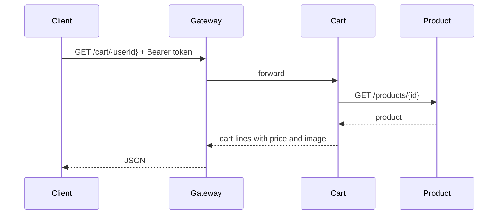
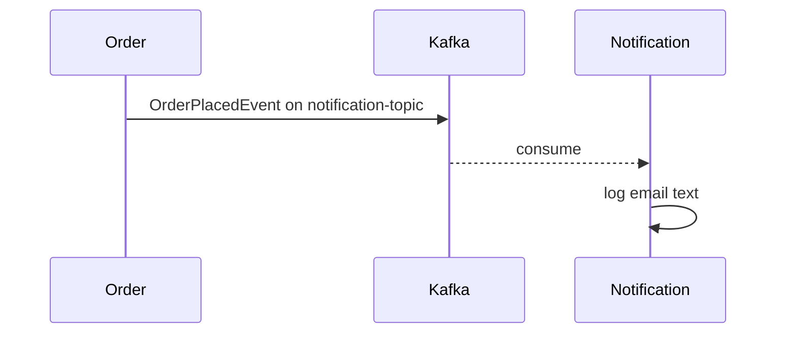

# 04 — Communication and Kafka Flow

The platform uses two styles of communication. Reads and checkout steps that need an answer now go over HTTP. Notifications were designed to go over Kafka. Only the HTTP half is active.

## 1. Synchronous HTTP

The caller waits for a body.

Other live HTTP links:

- Search to product: `GET /products/search?keyword=`
- Order to cart: `GET /cart/{userId}`
- Order to product: `GET /products/{id}`
- Order to payment: `POST /payments` when the payment endpoint is called

`placeOrder` itself does not make those calls. The cart, product, and payment methods on `OrderService` run only when their own controller endpoints are hit.

## 2. Intended Kafka flow

`OrderPlacedEvent` fields: `orderNumber`, `customerEmail`, `customerName`, `totalAmount`.

The send in `OrderService.placeOrder` is commented out, including the event object. Notification can listen, but nothing publishes, so the listener does not run during checkout.

Inventory and delivery do not have a `@KafkaListener`. They do not react to a new order.

## 3. Kafka configuration

Notification (`application.yml`) is valid:

- `spring.kafka.bootstrap-servers: localhost:9092`
- topic `notification-topic`
- group `notification-group`
- JSON value type `com.ecommer.event.OrderPlacedEvent`
- `spring.json.trusted.packages: *`

Order service nests Kafka under `spring.data.kafka`. Spring Boot reads `spring.kafka`, so those producer serializers are ignored. Docker Compose does set `SPRING_KAFKA_BOOTSTRAP_SERVERS` for the order container, which maps to the correct property when the app runs in Compose.

## 4. Checkout sequence as coded

1. Client sends an `Order` JSON to `POST /orders/place`.
2. Status becomes `Placed` and MongoDB stores it.
3. The method returns `Order Placed Successfully`.
4. Stock, payment, delivery, and notification stay unchanged.

A separate client call can hit `GET /orders/payment/{orderId}/{amount}?amount=`. That posts `{orderId, amount}` to payment, which stores status `Sucess`.

Cancel is `PUT /orders/orders/{orderId}/cancel`. It sets status `Cancel` and does not release stock or refund.

## 5. Sequence the checkout still needs

1. Load the cart for the authenticated user.
2. Price each line from the product service.
3. `POST /inventory/reserve` for the store and product. Stop if reserve returns false.
4. Save the order only after the price and stock checks.
5. Create a payment and store status `SUCCESS` only after verification.
6. Publish `OrderPlacedEvent` to `notification-topic`.
7. Let delivery create a `PENDING` shipment from that event.
8. On cancel, release stock and refund only a `SUCCESS` payment.

Razorpay test mode can replace step 5 later: create a Razorpay test order, confirm the signature, then save `SUCCESS`. Test keys (`rzp_test_...`) do not move real money.
